# OrgStudEase: Student Organization Event Registration and Check-In System

## Project Description

OrgStudEase is a simple Java console program designed for school organizations that conduct events and activities.

The system works similarly to an attendance system. During events, students usually need to register first before they can participate. They also need to check in once they arrive. When there are many attendees, keeping track of every student can become confusing, especially when several students are waiting to be checked in.

OrgStudEase was developed to help school organizations manage student registration and check-in during events. It provides a way to keep student records organized and manage the line of students waiting to check in. It also includes searching and sorting features to make student information easier to access.

## Objectives

- To develop a simple application that assists school organizations during events.
- To simplify student registration through automatically assigned registration numbers.
- To monitor the check-in status of registered students.
- To apply the FIFO principle in managing the student check-in queue.
- To implement Bubble Sort and Selection Sort to organize student records.
- To apply Java programming concepts, particularly ArrayLists, queues, loops, methods, and sorting algorithms.

## Use Cases and Features

### Student Registration
- Register a student using their full name.
- Automatically generate a registration number.
- Record the date when the student registered.

### Student Records
- View all registered students and their information
- Search for a registered student using their registration number.
- Check whether a student has already checked in.

### Check-In Queue
- Add a registered student to the queue.
- Process the next student in line.
- Display who is next without removing them from the queue.
- Display all students waiting for check-in.
- Check if the queue is empty and see how many students are waiting.

### Sorting
- Sort student names alphabetically using Bubble Sort.
- Sort registration numbers from lowest to highest using Selection Sort.
- Display the records before and after sorting.

## Data Structure Explanation

### ArrayLists
The system uses Java ArrayLists to store and manage the information of registered students. Separate ArrayLists are used for each type of student information instead of creating individual classes for student records.

The following ArrayLists are implemented:
- `ArrayList<Integer> registrationNumbers`: Stores student registration numbers assigned to students.
- `ArrayList<String> names`: Stores the full names of registered students.
- `ArrayList<String> registrationDates`: Stores dates when students registered.
- `ArrayList<String> status`: Stores the check-in status of each student.
    
Each ArrayList uses matching indexes to keep the information associated with the correct student. For example, all information stored at index 0 belongs to the same student.

When sorting is performed, the corresponding information in all four ArrayLists is also swapped. This maintains the correct relationship between each student's registration number, name, registration date, and status.
    
### Queue

A Queue implemented using LinkedList is used to manage students waiting for check-in.

```java
static Queue<Integer> checkInQueue = new LinkedList<Integer>();
```
The queue stores the registration numbers of students waiting to be checked in.

It follows the First-In, First-Out (FIFO) principle, which means that the student added first to the queue will also be the first one to be processed.

The following queue operations are implemented:
- `add()` – Adds a student's registration number to the queue.
- `poll()` – Removes and returns the registration number at the front of the queue.
- `peek()` – Returns the registration number at the front without removing it.
- `isEmpty()` – Checks whether the queue contains any students.
- `contains()` – Checks whether a registration number is already in the queue.

The queue handles the order of student check-ins, while the ArrayLists maintain the complete records of registered students.

## Sorting Algorithm Explanation

The system implements two sorting algorithms to organize student records according to their names and registration numbers. Both algorithms are manually implemented without using Java's built-in sorting methods.

### Bubble Sort
Bubble Sort is used to arrange student records alphabetically based on their names.

The algorithm compares two adjacent names and swaps their positions if they are not in alphabetical order. This process continues through repeated passes until all student names are arranged correctly.

### Selection Sort
Selection Sort is used to arrange student records according to their registration numbers in ascending order.

The algorithm searches for the smallest registration number in the unsorted portion of the records and places it in the correct position. This process repeats until all registration numbers are arranged from lowest to highest.

Both algorithms also swap the corresponding information in the four ArrayLists. This ensures that the registration number, name, registration date, and check-in status remain associated with the correct student after sorting.

## How to Run the Program

The program requires the Java Development Kit (JDK) to compile and run.

Follow these steps to run the program:

1. Download or clone this repository:
   ```
   git clone https://github.com/jcpalo/DSA-Java-Sorting-Queue-Capstone.git
   ```
2. Open a terminal and go to the folder that contains `Main.java`:
   ```
   cd DSA-Java-Sorting-Queue-Capstone/src
   ```
3. Compile the program:
   ```
   javac Main.java
   ```
4. Run the program:
   ```
   java Main
   ```
5. Type a menu number (1 to 11) and press Enter.

## Screenshots of the System

The following screenshots show the main features and actual outputs of OrgStudEase.

### 1. Main Menu

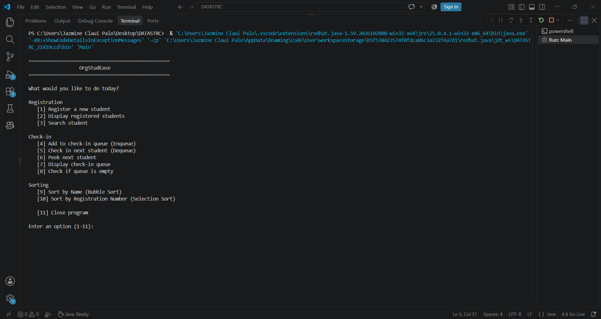

Displays the available operations of the system.

### 2. Student Registration

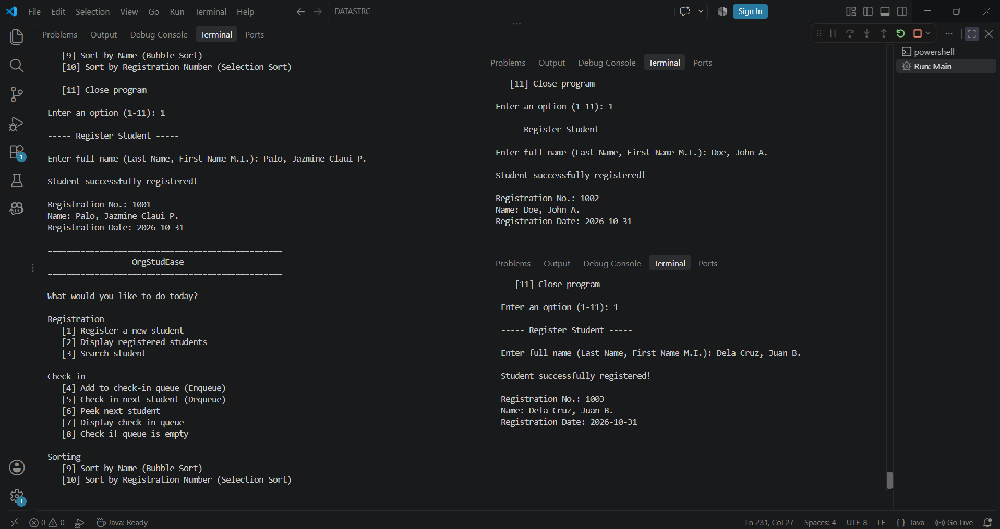

Shows the registration of students and the automatic assignment of registration numbers.

### 3. Display Registered Students

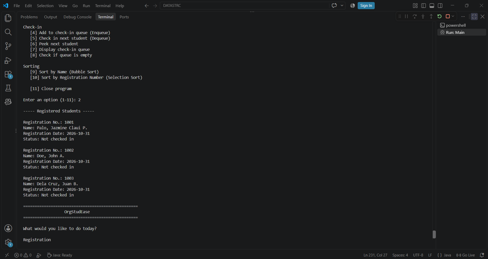

Shows the registered students and their corresponding information.

### 4. Search Student

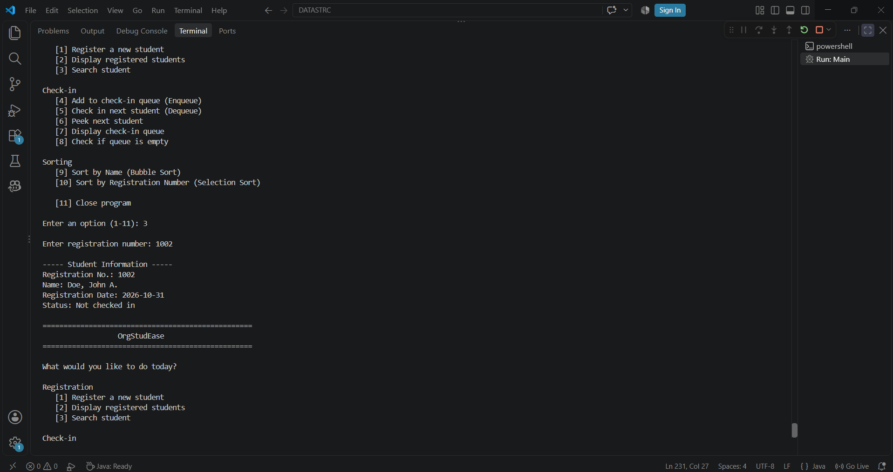

Shows how the system searches for a registered student using their registration number and displays their information.

### 5. Enqueue Operation


Shows how a registered student is added to the check-in queue.

### 6. Peek Next Student:

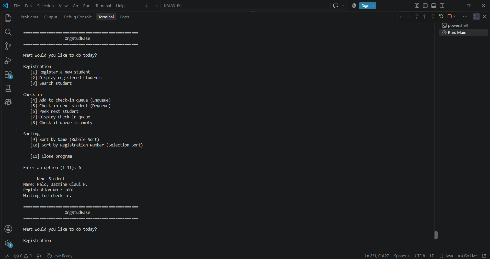

Shows the next student waiting in the queue without removing them.

### 7. Display Check-In Queue

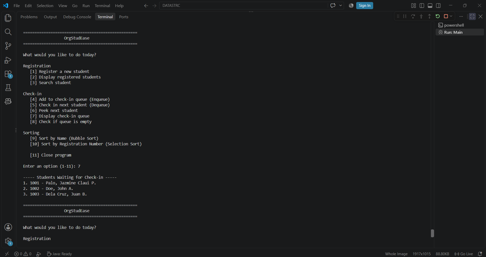

Shows the list of students currently waiting for check-in.

### 8. FIFO Demonstration

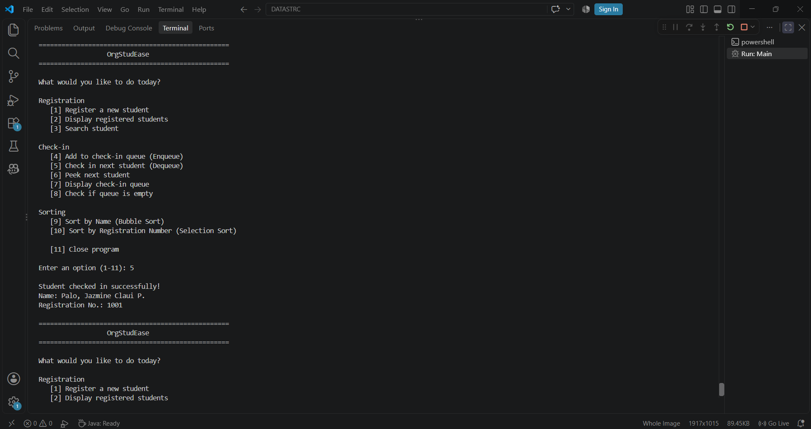

Demonstrates how the first student added to the queue is also the first student processed.

### 9. Queue Availability

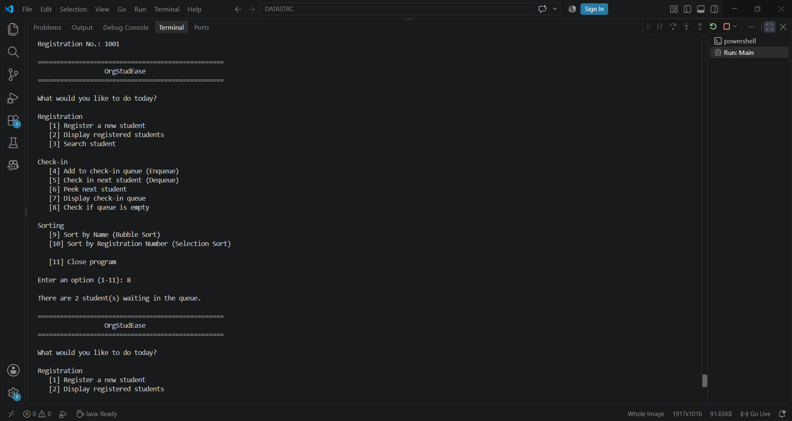

Shows whether the check-in queue is empty or still contains students waiting to be processed.

### 10. Bubble Sort

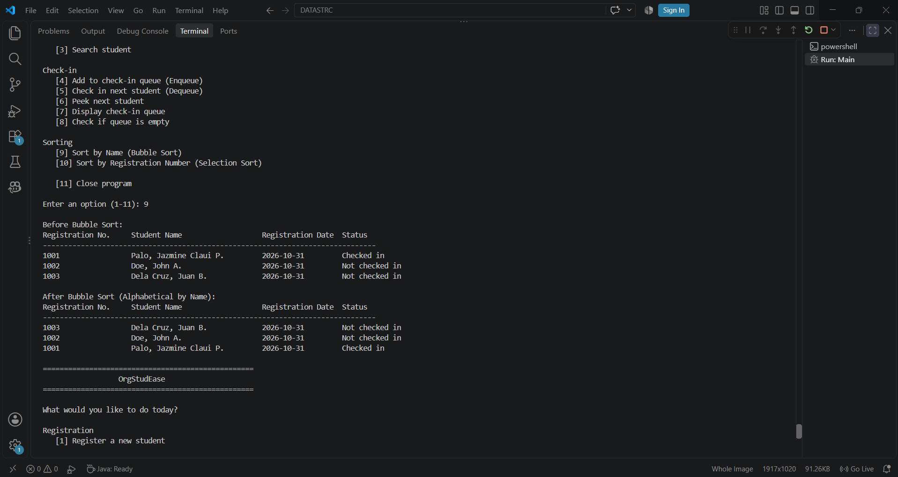

Shows the student records before and after sorting alphabetically by name using Bubble Sort.

### 11. Selection Sort

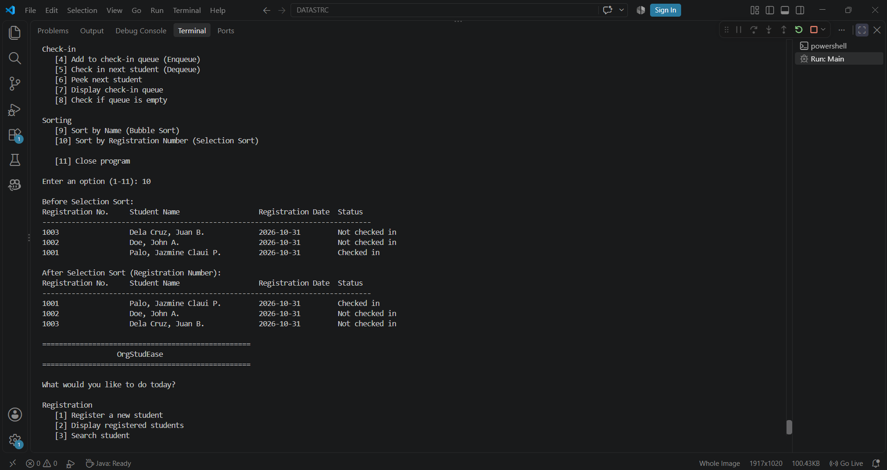

Shows the student records before and after sorting by registration number using Selection Sort.

### 12. Input Validation

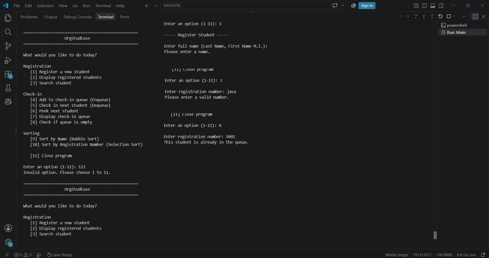

Shows how the system handles invalid inputs and displays appropriate error messages.